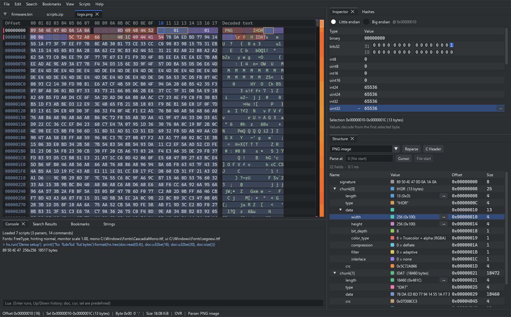
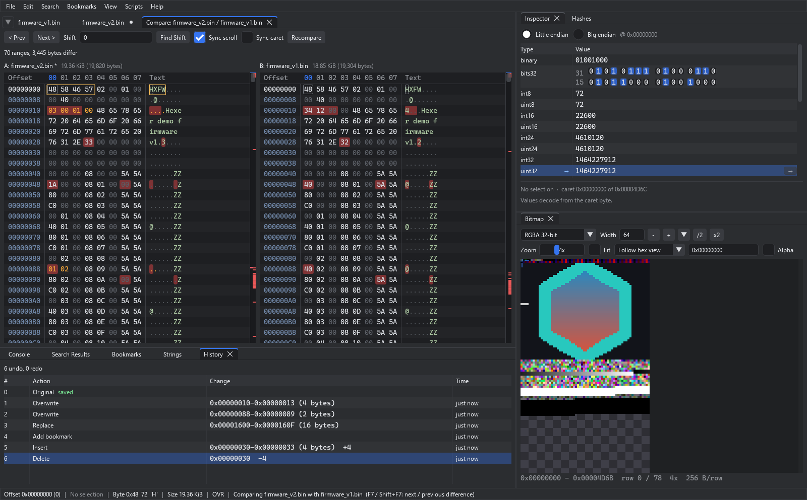
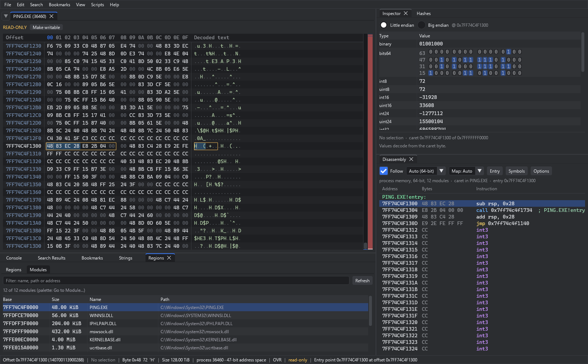

<p align="center">
  
</p>

<h1 align="center">Hexer</h1>

<p align="center">
  <b>A fast, modern, dark-mode hex editor for Windows and Linux.</b><br>
  Open multi-terabyte files instantly, undo anything (even after a restart), and let Lua scripts
  turn raw bytes into structures you can read and edit.
</p>

<p align="center">
  <a href="https://github.com/xXTurnerLP/Hexer/releases"><b>Download</b></a> ·
  <a href="#quick-start">Quick start</a> ·
  <a href="docs/features.md">All features</a> ·
  <a href="docs/scripting.md">Scripting guide</a> ·
  <a href="#building-from-source">Build from source</a>
</p>

<p align="center">
  <a href="https://github.com/xXTurnerLP/Hexer/releases/latest"></a>
  <a href="https://github.com/xXTurnerLP/Hexer/actions/workflows/ci.yml"></a>
  <a href="LICENSE"></a>
</p>



<sub>A PNG opened next to other tabs: the bundled parser builds the **Structure** tree and colors
every field in the hex view, the **Inspector** decodes the caret's bytes (click a bit to flip it),
the **Lua console** answers questions about the file, and the **minimap** next to the scrollbar
shows the entropy of the whole file.</sub>

## Why Hexer

- **Huge files, no waiting.** Files stream from disk in small blocks and are never loaded whole.
  A 3 TiB disk image opens as fast as a 3 KiB packet. Search, hashing and saving run in the
  background with progress and Cancel.
- **Undo everything, lose nothing.** Every edit, bookmark and view choice is undoable, the
  history survives saves and restarts, and a **History** panel lets you jump to any earlier state.
  Close Hexer at any time: unsaved work comes back exactly as you left it (Sublime-style hot exit).
- **Safe saving.** Same-size saves patch only the changed bytes; the original file is kept once
  as `<file>.backup`, so you can always compare with or revert to it.
- **Understand the bytes.** Lua parsers for PNG, ZIP and your own formats, a data inspector,
  strings, hashes and checksums, entropy minimap, bitmap view, XOR search and an x86 disassembler.
- **More than files.** Edit raw disks and the live memory of running processes, compare two
  files (even with inserted headers), and browse pcap / pcapng captures packet by packet.
- **Made to be pleasant.** Dark theme, tabs, split view, a command palette with every action,
  drag & drop, multi-selection, lenient paste (`DE AD`, `0xde,0xad`, `\xde\xad`, Base64) and
  shortcuts that stay out of the way while you type.

## Download

Grab the latest version from the **[Releases page](https://github.com/xXTurnerLP/Hexer/releases)**.
Nothing to install:

| Platform | File | How to run |
|---|---|---|
| Windows 10 / 11 (x64) | `hexer-windows-x64.zip` | Unzip anywhere, run `hexer\hexer.exe` (keep the `scripts` folder next to it) |
| Linux (x86_64) | `hexer-x86_64.AppImage` | `chmod +x hexer-x86_64.AppImage`, then run it |
| Linux (x86_64) | `hexer-linux-x86_64.tar.gz` | Unpack, run `hexer-linux-x86_64/hexer` |
| Linux (ARM64, experimental) | `hexer-aarch64.AppImage`, `hexer-linux-aarch64.tar.gz` | Same as x86_64 |

The Linux builds need glibc 2.35 or newer (Ubuntu 22.04, Debian 12, Fedora 36 and later); file
dialogs use xdg-desktop-portal, which GNOME, KDE and most desktops have. Every CI run also keeps
fresh packages as build artifacts for 7 days.

## Quick start

1. **Open a file:** drag it onto the window, press `Ctrl+O`, or run `hexer file.bin`. Several
   files open as tabs; drag tabs to reorder, middle-click to close.
2. **Edit:** type hex digits (or text in the text column). `Ins` switches between overwrite and
   insert. `Ctrl+Z` / `Ctrl+Y` undo and redo, as far back as you like.
3. **Find and jump:** `Ctrl+F` finds hex (with `??` wildcards) or text; `Ctrl+G` goes to an
   offset (expressions like `cur+4*0x10`, `end-0x100` or `50%` work); `Ctrl+B` bookmarks the
   selection; `Alt+Left` goes back.
4. **See the structure:** known formats are detected and parsed in the **Structure** panel; pick
   another parser there, or parse from the cursor with *Parse at*.
5. **Everything else:** `Ctrl+Shift+P` opens the command palette with every action, searchable.
6. **Close whenever you want.** There is no "save changes?" prompt; your unsaved edits, history
   and layout are back on the next start. `Ctrl+S` writes them to the file.

## A closer look



<sub>**Compare** two versions of a firmware image: changed bytes are red, your own unsaved edits
amber, and `F7` walks the differences (*Find Shift* lines up files where one has extra bytes).
The **History** panel lists every step with its time, so a click undoes back to it. The **Bitmap**
panel renders the bytes as pixels, which makes the embedded image (and any table or padding)
stand out.</sub>



<sub>**Process memory** (File > Open Process...): the live address space of a running program,
opened at its entry point. The **Disassembly** panel decodes x86-64 with module and export
labels, and the **Regions / Modules** panel lists the memory map. Raw disks open the same way
(File > Open Disk...). Both are read-only until you say otherwise; **Restart as Administrator**
keeps your session when Windows needs more rights.</sub>

## Features at a glance

**Editing**
- Overwrite and insert, fill, cut / copy / paste, *Copy as* hex, C array, Python, Base64 and more
- Multi-selection (`Alt+drag`, *Select All Matches*): copy, delete, fill or bookmark many ranges at once
- Full undo / redo that survives saves and restarts, with a History panel
- Inline editing of Inspector values, structure fields and bookmarks (double-click)
- Split view of one file, live tail for growing logs and captures

**Navigation and search**
- Find hex (with `??` wildcards), text and UTF-16 text, with *Find All* results
- Go to offset with expressions (`cur+4*0x10`, `end-0x100`, `50%`), bookmarks with names, notes and colors across all files
- Follow pointers (`Ctrl+click`), Back / Forward history, command palette

**Analysis**
- Data inspector: every integer and float width, both byte orders, times, GUIDs, LEB128, bit view
- Structure panel driven by Lua parsers (PNG, ZIP, TLV examples included), *Parse at* any offset,
  C struct definitions turned into parsers, export of a parse as a C header
- Strings (ASCII / UTF-16), 16 hashes and checksums (plus your own in Lua), XOR / ADD / ROL search
- Entropy and byte-class minimap, byte-class coloring, bitmap view
- Compare two files or a file with its saved / backup version, with automatic shift detection
- x86 / x86-64 disassembly with PE / ELF address maps and symbol names
- pcap / pcapng captures: packet list with filters, *Follow TCP / UDP Stream*, per-packet parsing

**Targets**
- Files of any size, raw disks and volumes, live process memory (Windows and Linux)

**Scripting**
- Lua 5.5 parsers, commands and hash algorithms that reload when you save them; a Lua console
  with the open document at hand

The **[feature reference](docs/features.md)** describes each of these in detail, along with hot
exit, every keyboard shortcut and the command line.

## Essential shortcuts

| Keys | Action |
|---|---|
| `Ctrl+O` / `Ctrl+S` / `Ctrl+W` | Open / save / close tab (`Ctrl+Shift+T` reopens it) |
| `Ctrl+Z` / `Ctrl+Y` | Undo / redo |
| `Ins` | Insert / overwrite |
| `Ctrl+F`, `F3` / `Shift+F3` | Find, next / previous |
| `Ctrl+G` | Go to offset |
| `Ctrl+B`, `F2` / `Shift+F2` | Toggle bookmark, next / previous bookmark |
| `Ctrl+Shift+C` | Copy as (hex, C array, Python, Base64, ...) |
| `Ctrl+click` / `Ctrl+Enter` | Follow the pointer under the mouse / at the cursor |
| `Alt+Left` / `Alt+Right` | Back / forward |
| `Alt+click` / `Alt+drag` | Add a range to the multi-selection |
| `F7` / `Shift+F7` | Next / previous difference (Compare tab) |
| `Ctrl+\` | Split view |
| `Ctrl+Shift+P` | Command palette |
| `Ctrl+wheel`, `Ctrl+=` / `Ctrl+-` | Zoom |

[All shortcuts and mouse gestures](docs/features.md#keyboard-shortcuts)

## Scripting

Put a `.lua` file in your scripts folder (Scripts > Open Scripts Folder). It loads at startup and
reloads every time you save it.

```lua
hx.parser {
    name = "My protocol",
    detect = function(doc) return doc:u8(0) == 0xAB end,
    parse = function(p, doc)
        p:endian("be")
        p:u8("magic", { fmt = "hex" })
        p:u8("type", { enum = { [1] = "TEXT", [2] = "PING" } })
        local len = p:u16("length")
        p:str("text", len)
    end,
}

hx.command {
    name = "My protocol: build a TEXT message",
    run = function(doc)
        hx.new_doc("message.myp", string.pack(">BBs2", 0xAB, 1, "hello"))
    end,
}
```

The console (bottom panel) is a Lua REPL: `doc`, `cur` and `sel` are predefined, so
`doc:read(cur, 16)` or `hx.hex(doc:read(sel.start, sel.len))` work straight away.

See **[docs/scripting.md](docs/scripting.md)** for the full guide and API reference, and
[`scripts/examples/`](scripts/examples) for complete parsers (PNG, ZIP, a TLV protocol),
commands, hash algorithms and packet scripts.

## Where Hexer keeps its data

Settings, the hot-exit session and your scripts live in `%APPDATA%\Hexer` on Windows and
`~/.config/hexer` on Linux (or `$XDG_CONFIG_HOME/hexer`). Run `hexer --config-dir DIR` for a
portable setup, and turn hot exit off in Edit > Settings if you prefer the classic prompts.

## Building from source

Meson downloads every dependency (Dear ImGui, GLFW, Lua, FreeType, nativefiledialog-extended,
Zydis, doctest) on first setup.

### Windows

You need Visual Studio 2022 or later with the C++ workload, Python, and `pip install meson ninja`.
`tools\meson.bat` finds Visual Studio and loads the MSVC environment for you:

```
tools\meson.bat setup build
tools\meson.bat compile -C build
tools\meson.bat test -C build
build\src\hexer.exe
```

From Git Bash, run `cmd //c "tools\\meson.bat compile -C build"`.

### Linux

Debian / Ubuntu:

```
sudo apt install build-essential meson ninja-build pkg-config \
    libx11-dev libxrandr-dev libxinerama-dev libxcursor-dev libxi-dev libgl-dev \
    libgtk-3-dev
meson setup build
meson compile -C build
meson test -C build
./build/src/hexer
```

- **File dialogs:** these use GTK 3 when `libgtk-3-dev` is installed. To avoid GTK, install
  `libdbus-1-dev` instead and Hexer uses the xdg-desktop-portal dialogs:
  `meson setup build -Dnativefiledialog-extended:xdg-desktop-portal=enabled`.
- **Wayland:** the bundled GLFW builds its X11 backend, which runs on Wayland through XWayland.
  For a native Wayland window, either install your distribution's GLFW 3.4 (`libglfw3-dev`),
  which Meson then prefers, or build the bundled one with
  `-Dglfw:display-api=wayland` (this also needs `libwayland-dev libxkbcommon-dev wayland-protocols`).
- Fedora package names: `libX11-devel libXrandr-devel libXinerama-devel libXcursor-devel
  libXi-devel mesa-libGL-devel gtk3-devel`.

GCC 11 or newer, or a recent Clang, is needed. CI builds and tests every push with GCC, Clang and
MSVC.

## Contributing

Bug reports and ideas are welcome in the issue tracker. The code is C++20 with an immediate-mode
UI: `src/core` holds documents, streaming I/O, the piece table, undo, saving, the session and the
analysis engines (no UI, no Lua); `src/script` is the Lua engine; `src/ui` is the Dear ImGui app.
Tests live in `tests/`, one executable per module, including headless UI tests that drive the
hex view with a simulated mouse and keyboard. [`CLAUDE.md`](CLAUDE.md) has the contributor notes
and conventions, [`TODO.md`](TODO.md) the roadmap.

## License

Hexer is released under the [MIT License](LICENSE). It is built on Dear ImGui, GLFW, Lua,
FreeType, Native File Dialog Extended and Zydis; their licenses are collected in
[`THIRD_PARTY_NOTICES.md`](THIRD_PARTY_NOTICES.md), which ships with every download.
